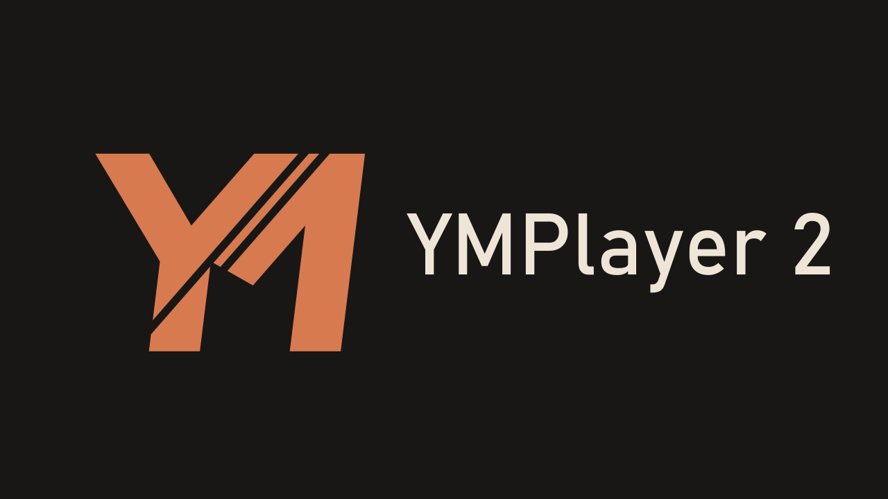

# YMPlayer2

Музыкальный плеер для Android: музыка из папок и USB,
Яндекс Музыка, эфирное радио и видеоклипы. Подходит для телефона, планшета, Android TV
и автомобильной магнитолы. Интерфейс адаптируется к экрану и управлению
касанием или пультом.

YMPlayer2 — самостоятельное приложение. Для работы версия 1.x не нужна;
при установке обеих версий их данные не смешиваются.

  

**[Скачать APK — 2.8.0-build144](https://github.com/reziarlleh/YMPlayer2/releases/latest)** ·
[Что нового](CHANGELOG.md) ·
[Обсуждение и APK на 4PDA](https://4pda.to/forum/index.php?showtopic=1127108)

[Резервная загрузка APK](https://cdn.jsdelivr.net/gh/reziarlleh/YMPlayer2@apk-2.8.0-build144/releases/2.8.0-build144/YMPlayer-2.8.0-build144.apk) ·
[Как пользоваться Радио](docs/USER_GUIDE.md#радио).

Требуется **Android 6.0 или новее**. Установка поверх предыдущей2.x сохраняет
настройки, аккаунты и музыку. «Моя волна» сохраняет очередь и позицию при
переключении на офлайн, локальную музыку или радио и обратно.

## Возможности

- **Музыка устройства и USB.** Выбор папок, обложки и теги, поиск по медиатеке,
  альбомы, исполнители и жанры. Локальные плейлисты с изменением порядка треков.
- **Яндекс Музыка.** Вход по коду, «Моя волна», рекомендации, поиск треков,
  исполнителей, альбомов и плейлистов. «Мне нравится», любимые исполнители
  и альбомы, редактирование своих плейлистов. Лайк и «никогда не предлагать»
  отдельно для трека и исполнителя.
- **Волны и режимы списков.** Настройки «Моей волны» по занятию, характеру,
  настроению и языку. Волна по треку, исполнителю, альбому или плейлисту.
  Продолжение волной после Яндекс-списка, бесконечный рандом и повтор
  списка/трека; эти режимы взаимно исключаются.
- **Музыка без сети.** Офлайн-синхронизация «Мне нравится» с обложками. Новые лайки треков
  загружаются автоматически при включённом кэше; без сети действия ждут подключения.
  Отдельные настройки качества онлайн-аудио и скачиваемых треков.
  Кэш можно полностью отключить, например на телевизоре с небольшим объёмом памяти.
  Папку кэша можно перенести на другой накопитель с проверкой свободного места и копии.
  При возврате из волны офлайн продолжает свой трек с сохранённой позиции и режимами.
- **Экспорт MP3.** Сохранение офлайн-музыки, Яндекс-альбомов и плейлистов в папку
  или на USB. Выбор 128, 192, 256 или 320 кбит/с. Редактируемый шаблон имён с предпросмотром и справкой по переменным,
  теги треков и защита существующих файлов от перезаписи.
- **Удобная медиатека.** История прослушивания, недавно добавленная музыка
  устройства/USB и выбор нескольких треков для очереди или локального плейлиста.
- **Пользовательские профили.** Встроенный Локальный для файлов устройства/USB
  и отдельные Яндекс-профили с именами аккаунтов. Свои плейлисты, избранное,
  офлайн-музыка, очередь, позиция, язык, тема, скин и масштаб. Обычное переключение
  открывает плеер выбранного пользователя на паузе.
- **Фоновый плеер.** Управление через уведомление и системные медиакнопки,
  редактирование очереди, повтор и перемешивание обычных списков.
  В «Моей волне» следующие треки выбирает Яндекс.
- **Радио.** Эфирные станции, коллекция, города, жанры и поиск; управление через плеер и медиакнопки.
- **Клипы.** Волна видеоклипов, управление касанием и пультом, информация о текущем
  и следующем клипе.
- **Оформление.** Светлая и тёмная темы, готовые скины и импорт собственного оформления.
  Ручной масштаб текста, кнопок и отступов от 50 до 200% с шагом 10%.
- **Боковая панель для K4811.** Настраиваемые кнопки громкости, плеера,
  навигации, сна и перезагрузки.
- **Обновления.** Проверка при запуске и вручную, резервный источник загрузки APK.

Интерфейс доступен на русском, английском, белорусском, казахском,
украинском, немецком, испанском и французском языках. По умолчанию язык
выбирается по системе; его можно сменить в настройках.

## Установка и начало работы

Скачайте APK и установите его. При запросе Android разрешите установку
из выбранного источника. Последующие обновления устанавливаются поверх
приложения с сохранением данных.

Для локальной музыки выберите папки в медиатеке. Для Яндекс Музыки нажмите
**Добавить профиль Яндекс** и войдите по коду. Готовый профиль появится с именем
аккаунта. Аккаунт Яндекса для локальных файлов не требуется.

На Android TV для выбора папок нужен системный файловый диалог или файловый
менеджер с поддержкой SAF. Он присутствует не во всех прошивках.
Офлайн-кэш загружает только понравившиеся треки; любимые исполнители
и альбомы целиком автоматически не скачиваются.

## Инструкции и помощь

- **[Руководство пользователя](docs/USER_GUIDE.md)** — разделы, кнопки, вход,
  профили, плейлисты, кэш, качество звука и настройки; со скриншотами.
- [English user guide](docs/USER_GUIDE_EN.md).
- [Готовые скины](skins/README.md) и [создание своего скина](docs/SKIN_AUTHOR_GUIDE.md).
- [История изменений](CHANGELOG.md).
- [Сообщить об ошибке](https://github.com/reziarlleh/YMPlayer2/issues)
  или [обсудить на 4PDA](https://4pda.to/forum/index.php?showtopic=1127108).

Если приложение закрывается с ошибкой, запустите его снова и экспортируйте
отчёт через **Настройки → Диагностика**. Приложите отчёт и шаги воспроизведения
к сообщению об ошибке.

## Поддержать разработку

Приложение бесплатное. Если оно вам нравится, можно поддержать автора:

   
  <a href="https://donate.stream/donate_6a60559cd9e35"><strong>Поддержать разработку</strong></a>

Для разработчиков: [сборка](docs/BUILDING.md), [участие](CONTRIBUTING.md),
[техническая документация и журналы](docs/DOCUMENTATION_INDEX.md).
